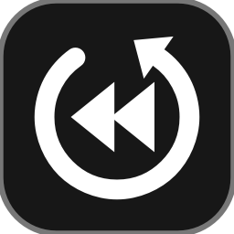

<p align="center">
  
</p>

<h1 align="center">Rewind</h1>

<p align="center">
  Instant replay for your screen.<br>
  <a href="https://rewindtake.com">rewindtake.com</a> · <a href="https://github.com/tnrjns/Rewind/releases/latest">Download</a>
</p>

<p align="center">
  <a href="https://github.com/tnrjns/Rewind/actions/workflows/ci.yml"></a>
  <a href="https://github.com/tnrjns/Rewind/releases/latest"></a>
  <a href="https://github.com/tnrjns/Rewind/releases"></a>
  
  <a href="LICENSE.md"></a>
</p>

Rewind always keeps the last 15–60 seconds of your screen in a buffer. Press a hotkey and those seconds are saved as a clip, with a sound to confirm. It runs on Windows 11 and macOS 13 or newer on Apple Silicon. Linux is coming.

## How it's different from OBS
OBS Studio is built for streaming and long recordings: scenes, sources, filters and plugins. Rewind does one thing. It keeps the last 15–60 seconds of your screen ready, and one key turns them into a clip.

- **Nothing to set up.** Open it and Instant Replay is already running. There are no scenes or sources to build.
- **Always on, barely there.** It lives in the tray (Windows) or menu bar (Mac). A small status pill shows that it's running, and it never shows up in your clips.
- **One key per job.** Save the replay, start or stop a recording, or take a screenshot, each with its own hotkey that works even in a game.
- **Lighter.** Measured on the same Mac with the same settings:

| | Rewind 1.1.0 | OBS Studio 33.0.1 |
|---|---|---|
| CPU | 14% of one core | 19% of one core |
| Memory | 308 MB | 428 MB |
| App size | 74 MB | 487 MB |

Both kept a 30 second replay buffer of a 1080p, 60 fps screen with Apple's hardware H.264 encoder at 6 Mbps, on an Apple M6 Mac running macOS 27. Rewind recorded desktop audio; OBS used a single screen capture source. CPU and memory are averaged over 30 seconds and count every process each app runs.

If you stream, or need scenes and overlays, use OBS. If you just want to catch the moment that already happened, use Rewind.

## Download
- **Windows 11:** get `Installer.exe` from the [latest release](https://github.com/tnrjns/Rewind/releases/latest) and run it. It sets up FFmpeg for you.
- **macOS 13+ (Apple Silicon):** get `Rewind.dmg` from the [latest release](https://github.com/tnrjns/Rewind/releases/latest), open it and drag Rewind into Applications. The app isn't signed by Apple yet, so the first time, run this once in Terminal:
  ```
  xattr -dr com.apple.quarantine /Applications/Rewind.app
  ```
  When Rewind opens, macOS asks for Screen Recording permission. Turn Rewind on in System Settings → Privacy & Security → Screen & System Audio Recording, then reopen it. Rewind downloads FFmpeg the first time Instant Replay turns on.

## Default hotkeys
| Action | Windows | macOS |
|---|---|---|
| Turn Instant Replay on/off | <kbd>Alt</kbd> + <kbd>F9</kbd> | <kbd>⌃</kbd><kbd>⌥</kbd><kbd>I</kbd> |
| Save clip | <kbd>Alt</kbd> + <kbd>F10</kbd> | <kbd>⌃</kbd><kbd>⌥</kbd><kbd>S</kbd> |
| Start/stop screen recording | <kbd>Alt</kbd> + <kbd>F11</kbd> | <kbd>⌃</kbd><kbd>⌥</kbd><kbd>R</kbd> |
| Take screenshot | <kbd>Alt</kbd> + <kbd>F12</kbd> | <kbd>⌃</kbd><kbd>⌥</kbd><kbd>P</kbd> |
| Open Rewind | <kbd>Alt</kbd> + <kbd>0</kbd> | <kbd>⌃</kbd><kbd>⌥</kbd><kbd>0</kbd> |

You can change all five on the **Hotkeys** page. Click a box, press the new combo, and it takes effect right away. **Reset to defaults** puts all five back. Rewind tells you when a combo is taken. On Windows, NVIDIA's overlay often owns Alt+F10 already, so turn off NVIDIA Instant Replay or pick a different combo. On Mac, a combo needs ⌃ or ⌘, because macOS blocks ones that only use ⌥ and ⇧.

## Run from source (Windows)
1. Unzip the `Rewind` folder somewhere permanent, like `Documents\Rewind`.
2. Double-click **install.bat**. It installs the Python packages, downloads FFmpeg, adds Desktop and Start-menu shortcuts, then opens Rewind.
   - If Python isn't installed, the script installs it and asks you to run `install.bat` again.
3. After that, open Rewind from the Desktop shortcut or the Start menu. While it's running in the tray, press **Alt + 0** from anywhere to bring the window up. Turn on *Launch when Windows starts* (General page) so Alt + 0 always works.
   - Shortcut missing? Double-click **Create Shortcut.bat**, or click *Create shortcut* on Rewind's General page.

## Run from source (macOS)
```
python3 -m venv .venv && .venv/bin/pip install -r requirements.txt
mkdir -p bin && swiftc -O macos/rewind-audio.swift -o bin/rewind-audio
.venv/bin/python main.py
```
`bin/rewind-audio` is a small ScreenCaptureKit helper that records the Mac's own sound. Build `Rewind.dmg` with `./build_macos.sh`.

## Features
- **Clip length:** 15–60 seconds, in 5-second steps (slider or quick chips)
- **Bitrate:** 5–150 Mbps (slider or presets), with an estimate of the file size
- **Encoder:** the graphics chip does the work, found on its own: NVIDIA NVENC, AMD AMF or Intel Quick Sync on Windows, Apple VideoToolbox on Mac. If none works, it uses the CPU (x264).
- **Codec:** H.264 or HEVC. Frame rate: 30, 60, 120 or 144. Resolution: native, 1440p, 1080p or 720p. Pick a monitor if you have more than one.
- **Audio:** the sound your computer plays, plus your microphone if you want it, with a volume control for each
- **Full recordings:** open the **Recording** page for a live preview of the selected monitor and start/stop controls, or press the record hotkey. Rewind saves an MP4 with desktop audio and optional microphone audio, then resumes Instant Replay if it was on before. The preview is a desktop thumbnail and may not show exclusive-fullscreen content.
- **Clip sound:** chime, pop, blip or your own .wav, with adjustable volume
- **Screenshots:** press the screenshot hotkey, or use the button on Home or in the tray / menu bar menu. They're saved as PNG or JPG in the same folder as your clips, with a shutter sound and a neutral "Screenshot" badge. They work over games because they use the same capture method as the recorder.
- **Status icon:** a small pill tucked into the bottom-right corner by default. It says whether Rewind is ON or OFF. It changes to a green "Clip saved" when a clip lands. Clicks pass through it, it never takes focus, and it's hidden from screen capture, so it never shows up in your clips.
- **Clips page:** thumbnails of your clips and screenshots, with filters for All, Clips and Screenshots. Double-click one to play it. Right-click to copy it (you can paste the file straight into Discord), rename it or delete it.
- **Tray / menu bar icon:** closing the window keeps Rewind running in the background. It can also start when you log in.

Clips and screenshots are saved to `Videos\Rewind` on Windows and `Movies/Rewind` on macOS. You can change the folder on the Replay page.

## Make a standalone .exe (optional)
Run `build_exe.bat`. It creates `dist\Rewind\Rewind.exe`, which runs without Python. Keep everything in that folder together.

## Build `Installer.exe`
Run `build_installer.bat` on a Windows build machine with Python 3.10+ and Inno Setup 6 installed. It creates `dist\Installer.exe`. The installer installs Rewind per-user, adds Start Menu and optional desktop shortcuts, and downloads FFmpeg from Gyan if it is not already installed. Internet access is required when downloading FFmpeg.

## Troubleshooting
- **"FFmpeg wasn't found" (Windows):** run `install.bat` again, or put `ffmpeg.exe` in `Rewind\ffmpeg\bin\`.
- **Rewind can't record on a Mac:** turn Rewind on in System Settings → Privacy & Security → Screen & System Audio Recording, then quit and reopen it.
- **Recording fails or looks choppy:** on the Replay page, change **Encoder** from Automatic to another option. The data folder (General → Open data folder) has `ffmpeg.log` with details.
- **You can't see the status icon in a game:** games in exclusive fullscreen draw over everything. Switch the game to *Borderless* or *Windowed fullscreen*.
- **Audio is slightly out of sync:** nudge **Audio sync offset** on the Replay page. Positive values fix sound that comes too early.

## License
Rewind is licensed under the [Functional Source License, Version 1.1, ALv2 Future License](LICENSE.md). Copyright 2026 Tanner Jensen and Colin Jaxon.
